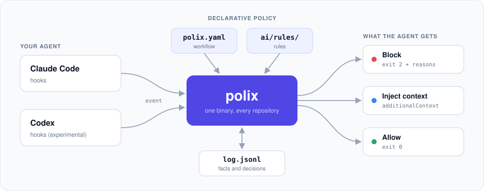
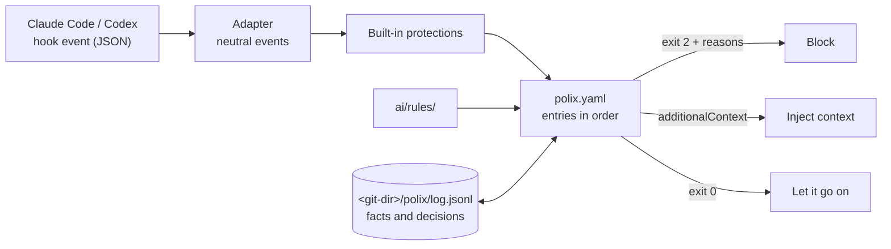

<div align="center">

# Polix

**Guardrails for coding agents, written as policy instead of scripts.**

Turn your team's engineering workflow into a file the agent cannot ignore.
One static binary connects Claude Code and Codex to the workflow and rules of your repository through their hooks.

[](https://github.com/mlophez/polix-ai/actions/workflows/ci.yml)
[](https://github.com/mlophez/polix-ai/releases/latest)
[](go.mod)
[](LICENSE)


[Engine and harness](#the-engine-and-the-harness) ·
[Quick start](#quick-start) ·
[How it works](#how-it-works) ·
[polix.yaml](#the-workflow-in-one-file) ·
[Why not shell scripts?](#why-not-a-few-shell-scripts) ·
[Docs](docs/polix.md)

</div>

---

<p align="center">
  
</p>

## The problem

You wrote it down in `AGENTS.md`: *run the tests before you commit, get the diff reviewed, never push to main.*
The agent agrees, and then, forty tool calls later, it forgets.

Instructions in a prompt are suggestions. Hooks can enforce them, but a pile of shell scripts per repository gets
fragile quickly. Each one parses JSON with `jq`, has no memory between calls, breaks on Windows and drifts away from
the copy in the next repository.

## The idea

**Polix** gives you one declarative file, `polix.yaml`, that says what must happen on each event of an agent
session: what is blocked, what is required, what runs, what is injected into the context and what is recorded.
The same binary answers every hook in milliseconds and keeps an append-only log of what it observed and decided.

```yaml
# polix.yaml
on:
  post_command:
    # A green `just test` records the fact "tested" for this exact content.
    - if: { command: "just test*", exit: 0 }
      record: tested

  stop:
    # The agent cannot end its turn with Go changes that were not tested as they are now.
    - if: { changed: "*.go" }
      unless: { done: tested }
      deny: "Tests have not passed on this diff: run just test"
```

If the agent edits a single line after the tests pass, the fact no longer applies and it has to run them again.
You don't have to invalidate anything by hand.

> The human writes the rules. Polix only enforces them.
> It **measures and never judges**: conditions are facts about the repository, the event and the state.
> Judging the code itself is left to a reviewer subagent.

## Highlights

- **Facts tied to content, not to time.** `record: tested` stores the fact together with the hash of the working
  tree. Any later edit changes the hash, so `done: tested` stops holding by itself.
- **Declarative and validated.** `polix check` rejects unknown events, keys, conditions, placeholders and
  conditions that can never hold on their event, so a typo cannot quietly switch a guardrail off.
- **Roll out safely.** Every entry can run in `audit` mode (only log what it would have blocked), then `warn` (tell
  the agent), then `enforce` (block).
- **Built-in protections.** Nobody can tamper with the state, and subagents can never rewrite `AGENTS.md`,
  `CLAUDE.md`, `ai/rules/` or `polix.yaml`. These protections apply even when the repository has no workflow.
- **Rules that reach the agent and CI.** Rules in `ai/rules/` have a scope. Polix injects only the ones that
  match the file being edited, once per session. The same checks run in CI with `polix rules check --changed`.
- **No infinite loops.** A loop guard lets the agent stop after `max_stop_blocks` identical blocks. A broken
  `polix.yaml` fails closed for edits and commands but never traps a stop.
- **An audit trail.** Every decision is logged with the entry that caused it, giving evidence of the process
  each change followed.
- **Truly cross-platform.** A static Go binary for Linux, macOS and Windows (amd64 and arm64), tested on all
  three in CI. The hooks work the same under `sh`, Git Bash and PowerShell.
- **Fast.** About 13 ms per hook call, and about 130 ms for a stop that hashes a 730-file repository (measured
  on macOS).

## The engine and the harness

Polix comes in two layers, and the second one is optional.

- **The engine** is the binary, `polix.yaml` and `ai/rules/`. It enforces whatever process you write down and
  assumes none: use it with your own skills, agents and conventions.
- **The harness** is a small set of best practices that ships in the plugin `polix`, for teams that want a
  development flow ready to use. Each phase is a skill run by its own subagent, with a clean context and a
  structured output that the next phase reads:
  - **plan**: turns a request into a plan with its scope, steps and how each step is verified, before any edit.
  - **build**: implements the plan step by step and runs the tests of each step.
  - **review**: reviews the diff against the plan and `ai/rules/`, and reports findings without fixing them.
  - **document**: updates the documentation and the comments that the change made stale.

The harness is not enforced by itself. A skill only helps the agent; Polix enforces a phase when your
`polix.yaml` says so, for example by recording a fact when a phase ends and requiring it before a commit:

```yaml
on:
  subagent_stop:
    - if: { actor: "polix:reviewer" }
      record: reviewed
  pre_commit:
    - unless: { done: [tested, reviewed] }
      deny: "Test and review the diff before committing"
```

Adopt the whole flow, a single phase or none of it.

> The harness is in progress. Today the plugin holds the skills that set Polix up (`/polix:workflow`,
> `/polix:add-rule`, `/polix:doctor`, `/polix:init`), the skills `/polix:plan`, `/polix:review` and
> `/polix:audit`, and the agents `polix:workflow-author`, `polix:rules-author`, `polix:reviewer`,
> `polix:rules-reviewer` and `polix:auditor`.

## Quick start

**1. Install the binary**

```bash
# macOS and Linux (also Windows with Git Bash)
curl -fsSL https://github.com/mlophez/polix-ai/releases/latest/download/install.sh | sh
```

```powershell
# Windows (PowerShell)
powershell -NoProfile -ExecutionPolicy Bypass -Command "irm https://github.com/mlophez/polix-ai/releases/latest/download/install.ps1 | iex"
```

```bash
# Or with Go
go install github.com/mlophez/polix-ai/cmd/polix@latest
```

The installers verify the binary against `checksums.txt` before installing it. Set `POLIX_VERSION` to pin a
version and `POLIX_INSTALL_DIR` to change the install folder.

**2. Install the plugin and register the hooks**

From the root of the repository:

```bash
polix install                     # the plugin for you and the hooks for this repository
polix install --user              # only the plugin, from anywhere (the installers already ran it)
polix install --agent claude      # only Claude Code (default: Claude Code, and Codex when it is used)
```

`polix install` sets up two things, and running it again only updates what changed:

- **For you, the plugin `polix`.** It holds the skills `/polix:workflow`, `/polix:add-rule`, `/polix:doctor`,
  `/polix:init`, `/polix:plan`, `/polix:review` and `/polix:audit` and the agents `polix:workflow-author`,
  `polix:rules-author`, `polix:reviewer`, `polix:rules-reviewer` and `polix:auditor`.
  The plugin ships inside the binary: Polix writes it to the local marketplace `~/.polix/marketplace/` and
  registers it with `claude plugin install polix@Polix --scope user` (for Codex, it enables it in
  `~/.codex/config.toml`).
  Start a new session to load it.
- **For the repository, the hooks.** They go in `.claude/settings.json` (and `.codex/hooks.json` for Codex),
  keeping every other setting and hook of those files. Commit them with your workflow so the team gets them.

Every hook calls the same command, as in [`examples/claude-settings.json`](examples/claude-settings.json):

```json
{ "type": "command", "command": "polix hook claude", "timeout": 900 }
```

`SessionStart` also runs `polix update --hook` when a session starts: Polix keeps itself up to date. It looks for a
new release at most once an hour, or at every start when it rejects the `polix.yaml` of the repository, which may
need a newer Polix (`requires: 0.2.0` in `polix.yaml` says so). It replaces the binary and refreshes the plugin,
and then runs `polix doctor --hook`, which tells the agent about any problem of the machine. `POLIX_NO_UPDATE=1`
turns the update off. Development builds (`just install`) never update themselves. Details in
[docs/polix.md](docs/polix.md).

`polix update` refreshes the plugin with each new binary, and `polix uninstall` removes the plugin and the hooks
of the repository (`--user` for only the plugin).

**3. Write your workflow**

Start from [`examples/polix.yaml`](examples/polix.yaml), an annotated reference of every option, and validate it:

```bash
polix check     # validate polix.yaml and ai/rules/
polix graph     # draw the workflow as a Mermaid diagram
polix doctor    # check that this machine and repository are ready
```

**4. Tell the agent**

Paste [`examples/AGENTS-polix.md`](examples/AGENTS-polix.md) into your `AGENTS.md` or `CLAUDE.md`. If a teammate
does not have Polix yet, the agent offers to install it, and only runs the install with their approval.

## How it works



1. The **adapter** turns the agent's hook input into neutral events. An edit of three files becomes three
   `pre_edit` events, and a `git commit` inside a shell command also raises `pre_commit`.
2. The **engine** applies the built-in protections, then the entries of the event in file order.
3. The adapter **answers** the agent. It exits with code 2 and the reasons on stderr to block, or with code 0 and
   `additionalContext` to inject guidance.

Every observation and decision ends up in the log, which lives inside the git directory, so it never appears in a
diff:

```text
$ polix log --tail 3
2026-11-04T12:04:04+01:00  stop_block stop          session                    efd99ae6  Tests have not passed on this diff: run just test
2026-11-04T12:04:04+01:00  decision   stop          session   block deny       efd99ae6  Tests have not passed on this diff: run just test
2026-11-04T12:04:13+01:00  fact       post_command  session   tested           efd99ae6
```

## The workflow in one file

`polix.yaml` is a list of entries per event. Each entry has optional conditions and exactly one action.

```yaml
version: 1
base: main
vars:
  key: { branch: "^([A-Z][A-Z0-9]+-[0-9]+)" }    # PLAT-123-add-retry -> PLAT-123

on:
  pre_edit:
    - unless: { var: key }
      deny: "No ticket in the branch name: create the branch from a ticket"
    - context: { rules: "{path}" }                # inject the rules that apply to this file

  pre_command:
    - if: { command: ["git push*origin main*", "git push*origin HEAD:main*"] }
      deny: "No direct pushes to main: open a pull request"

  post_command:
    - if: { command: "just test*", exit: 0 }
      record: tested

  subagent_stop:
    - if: { actor: reviewer }
      record: reviewed

  pre_commit:
    - unless: { done: [tested, reviewed] }
      mode: warn                                  # try it first, enforce it later
      deny: "Test and review the diff before committing"
```

**Events:** `session_start`, `prompt`, `pre_edit`, `post_edit`, `pre_command`, `post_command`, `pre_commit`,
`subagent_stop`, `stop`.

**Conditions:** `branch`, `var`, `path`, `changed`, `file` (optionally with `contains`), `command`, `exit`,
`actor`, `done`, `not`.

**Actions:** `deny`, `allow`, `require`, `run` (a command or the checks of the matching rules, optionally
recording a fact when it passes), `context` (a
file, a text or the matching rules), `record`.

**Modes:** `enforce`, `warn`, `audit`.

Commands are split and matched the way a shell runs them. In `cd x && just test 2>&1 | tail -3`, Polix sees three
commands. It also knows that `tail` decides the exit code, so a piped `just test` is not counted as a green run.

The full reference, with comments on every option, is in [`examples/polix.yaml`](examples/polix.yaml).

## Why not a few shell scripts?

Shell hooks are fine for one trivial check. Polix is for when guardrails are part of how a team works.

- **State.** A shell hook has no memory between calls. Polix keeps facts tied to the exact content of the tree,
  so "tested" means tested *as it is now*.
- **Correctness.** Splitting command lines, respecting quotes, knowing which command decides the exit code of a
  pipeline and detecting `git commit` all live in one tested engine instead of a `case` statement per repository.
- **Safety.** Schema validation, fail-closed on broken config, a loop guard on stop and a shared time budget for
  every `run` in one hook call.
- **Portability.** Claude Code can run hooks under PowerShell on Windows, where `sh` scripts do not run at all.
- **Rollout and evidence.** `audit` and `warn` modes to introduce new rules gradually, and a log that shows why
  each block happened.
- **One thing to maintain.** One binary across every repository, with `polix update` (checksum-verified, atomic
  replace) and `polix doctor`, instead of slightly different copies of the same scripts.

## Commands

```text
polix hook claude              entry point of the Claude Code hooks (event on stdin)
polix hook codex               entry point of the Codex hooks (experimental)
polix check                    validate polix.yaml and ai/rules/
polix rules check [--changed]  run the checks of the deterministic rules (for CI)
polix graph                    print the workflow as a Mermaid diagram
polix log --tail 20 [--json]   print the last entries of the state log
polix doctor [--hook]          check that this machine and repository are ready
polix update [--version V]     replace the binary with a release, verified and atomic
polix install [--user]         install the plugin for the user and register the hooks in the repository
polix uninstall [--user]       remove the plugin and the hooks of the repository
polix version
```

Most commands accept `--dir <repo>`; `version`, `update` and `hook` work on the working directory.

## Dogfooding

This repository is governed by its own Polix: [`polix.yaml`](polix.yaml), [`ai/rules/`](ai/rules) and the hooks in
[`.claude/settings.json`](.claude/settings.json). An agent working on Polix cannot end a turn with untested Go
changes, and the gofmt rule runs as a deterministic check.

## Development

```bash
just test       # go vet + go test
just build      # build/polix
just install    # go install, the binary the hooks run
just check      # install, then check this repository's config, rules and machine
just release 0.2.0
```

Code lives in `cmd/polix` and `internal/` (`agent`, `engine`, `workflow`, `rules`, `state`, `cli`, `setup`,
`update`, `version`, `gitx`, `glob`, `shell`). The plugin lives in `plugins/polix/`, embedded in the binary; check it with
`claude plugin validate plugins/polix`. CI runs on Linux, macOS and Windows, including the PowerShell installer
under Windows PowerShell 5.1 and PowerShell 7.

## Status

Polix is a **proof of concept**. It works and governs its own repository, but some things are still open:

- Codex support is experimental.
- The harness has its plan and review phases; build and document are not written yet.
- The log grows without bound and is appended without a lock.
- Releases are verified with checksums but are not signed yet.

The full list is in [docs/polix.md](docs/polix.md#limits-of-the-proof-of-concept).

## License

[Apache 2.0](LICENSE)
