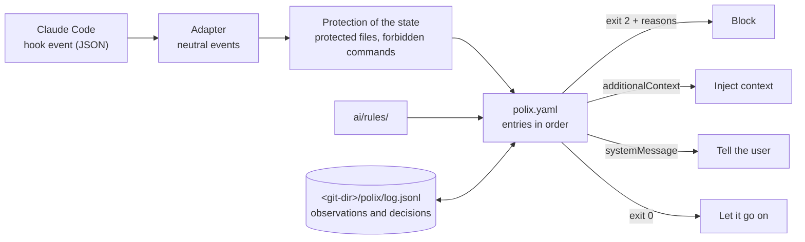

<div align="center">

# Polix

**Declarative guardrails for Claude Code: one `polix.yaml` decides what the agent may not touch, what must pass and
what runs at every step.**

One static binary that works with Claude Code through its hooks; Codex support is not implemented.

[](https://github.com/mlophez/polix-ai/actions/workflows/ci.yml)
[](https://github.com/mlophez/polix-ai/releases/latest)
[](go.mod)
[](LICENSE)


[Engine and harness](#the-engine-and-the-harness) ·
[Quick start](#quick-start) ·
[How it works](#how-it-works) ·
[polix.yaml](#the-workflow-in-one-file) ·
[Use cases](docs/use-cases.md) ·
[Why not shell scripts?](#why-not-a-few-shell-scripts) ·
[Status](#status) ·
[Docs](docs/polix.md) ·
[Changelog](CHANGELOG.md)

</div>

---

<p align="center">
  
</p>

## The problem

You wrote it down in `AGENTS.md`: *run the tests before you commit, get the diff reviewed, never push to main.*
The agent agrees, and then, forty tool calls later, it forgets.

Instructions in a prompt are suggestions. Hooks can enforce them, but a pile of shell scripts per repository gets
fragile quickly. Each one parses JSON with `jq`, has no memory between calls, breaks on Windows and drifts away from
the copy in the next repository.

## The idea

**Polix** gives you one declarative file, `polix.yaml`, that says what must happen on each event of an agent
session: what is blocked, what runs and what is injected into the context.
The same binary answers every hook in milliseconds and keeps an append-only log of what it observed and decided.

Save this as `polix.yaml` at the root of the repository:

```yaml
version: 1

guardrails:
  # No agent writes these files, the main session included.
  protected_files: [".env", "*.pem"]

  # No agent runs these commands; the reason goes back to the agent.
  forbidden_commands:
    - pattern: "git push*--force*"
      reason: "Force pushes rewrite shared history: ask a person to run it."

  # Nobody commits on these branches.
  protected_branches: [main]

  # The agent cannot end its turn while a check fails.
  run_on_stop:
    - run: go test ./...
      changed: "*.go"

on:
  pre_commit:
    # A commit needs the reviewer subagent to have seen the diff as it is now.
    - unless:
        finished: polix:reviewer
      action:
        block: "Review the diff with the polix:reviewer subagent, then commit again."
```

`guardrails:` are the basics: the files and the commands are protections of the engine, applied before everything
else, to every agent and also to the files git ignores; `protected_branches` and `run_on_stop` are shortcuts
that expand into ordinary entries of `on:`. `on:` is where your own flow goes, here a review before every commit:
Polix sees the reviewer subagent end and remembers which content it saw, so editing a line afterwards asks for a new
review.

This is a file like it at work ([`docs/assets/demo/polix.yaml`](docs/assets/demo/polix.yaml)), in a real Claude
Code session asked to *add a Reverse function with a test and commit it*. Polix blocks the commit on `main` and then
the commit without a review, and Claude recovers by itself: a branch, the reviewer, the tests Polix runs, the commit.

<p align="center">
  
</p>

<p align="center"><sub>
  Recorded with <code>just demo</code> from <a href="docs/assets/demo/demo.tape"><code>docs/assets/demo/demo.tape</code></a>,
  sped up.
</sub></p>

A fuller set of guardrails, with a formatter after each edit and a linter before the end of a turn, opens
[the workflow section](#the-workflow-in-one-file).

When the tests fail, the agent gets their output and has to go on. When they pass, Polix remembers it for this
exact content, so the next stop does not run them again; if the agent then edits a single line, they run again.
You don't have to invalidate anything by hand, and a `go test` the agent ran by itself never counts: Polix only
trusts what it ran.

`polix.yaml` has two layers. `guardrails:` holds the basics every project wants from the first minute.
`on:` is where your team orchestrates its flow: the review subagents, the builder, the plan, the ticket, each
an entry that says on which event it applies, when, and what it does
([below](#the-workflow-in-one-file)).

> The human writes the rules. Polix only enforces them.
> It **measures and never judges**: conditions are facts about the repository, the event and the state.
> Judging the code itself is left to a reviewer subagent.

## Highlights

- **Tied to content, not to time.** A check Polix ran green is not run again on the same content, and
  `finished: polix:reviewer` holds once the reviewer ended, until a file it looks at changes. Polix remembers only
  what the workflow asks about.
- **Gates and reminders.** A `block` holds every time until its `unless` does; `once: true` turns it into a
  reminder that asks once per content. A warning for the AI is an `inject`, a notice for the person is a `notify`,
  and the first entry that blocks ends the evaluation.
- **Declarative and validated.** `polix config check` rejects unknown events, keys, conditions, placeholders and
  conditions that can never hold on their event, so a typo cannot quietly switch a guardrail off.
- **Guardrails in a few lines.** `guardrails:` lists the files no agent writes, the commands no agent runs, the
  branches nobody commits on, the formatter of each edited file and the checks before the end of a turn. The files
  and the commands are protections applied before everything else, which bind the main session too and cover the
  files git ignores, such as `.env`. On its own Polix only keeps anyone from tampering with its state, even when
  the repository has no workflow; the condition `writes` keeps some actors away from some paths, as in
  [the recipe](docs/use-cases.md#paths-no-agent-writes).
- **Rules that reach the agent and CI.** Rules in `ai/rules/` have a scope. Polix injects only the ones that
  match the file being edited, once per session and agent. The same checks run in CI with
  `polix rules check --changed --base="${{ github.base_ref }}"` on a pull request, after a checkout with
  `fetch-depth: 0` ([the recipe](docs/use-cases.md#the-same-checks-for-the-agent-and-for-ci)).
- **No infinite loops.** A loop guard lets the agent stop after `max_stop_retries` identical blocks. A broken
  `polix.yaml` fails closed for edits and commands but never traps a stop.
- **An audit trail.** Every decision is logged with the entry that caused it, next to the checks that passed and
  the subagents that finished on each content, giving evidence of the process each change followed.
- **Truly cross-platform.** A static Go binary for Linux, macOS and Windows (amd64 and arm64), tested on all
  three in CI. The hooks work the same under `sh`, Git Bash and PowerShell.
- **Fast.** About 13 ms per hook call, and about 130 ms for a stop that hashes a 730-file repository (measured
  on macOS).

## The engine and the harness

Polix comes in two parts, and the second one is optional.

- **The engine** is the binary, `polix.yaml` and `ai/rules/`. It enforces whatever process you write down and
  assumes none: use it with your own skills, agents and conventions.
- **The harness** is a small set of best practices that ships in the plugin `polix`, for teams that want a
  development flow ready to use. Each phase runs in its own subagent, with a clean context and a structured output
  that the next phase reads:
  - **plan** (`/polix:plan`): turns a request into a plan with its scope, tasks and how each task is verified,
    before any edit.
  - **build** (`/polix:build`, run by `polix:builder`): implements the plan, one builder per task and several at
    once on tasks that do not depend on each other, updates the docs, then reviews the change and checks the
    acceptance criteria.
  - **review** (`/polix:review`, run by `polix:reviewer`): reviews the change against its intent and `ai/rules/`,
    and reports findings without fixing them.

The harness is not enforced by itself. A skill or agent of the plugin runs only when you or your `polix.yaml` ask
for it, never on the initiative of the model; Polix enforces a phase when your `polix.yaml` says so, for example by
requiring that the reviewer finished on the diff before a commit, and by running the tests itself:

```yaml
on:
  pre_commit:
    - unless: { finished: "polix:reviewer" }    # Polix observes the end of the reviewer by itself
      action: { block: "Review the diff with /polix:review before committing" }
    - action: { run: just test }
```

Adopt the whole flow, a single phase or none of it.

> The harness is in progress: plan, build and review exist, and a document phase is not written yet. Today the
> plugin holds the skills that set Polix up (`/polix:workflow`, `/polix:add-rule`, `/polix:doctor`, `/polix:init`),
> the skills `/polix:plan`, `/polix:build`, `/polix:review` and `/polix:audit`, and the agents `polix:workflow-author`,
> `polix:rules-author`, `polix:builder`, `polix:reviewer`, `polix:rules-reviewer` and `polix:auditor`. Every report
> follows a fixed template, and `/polix:review` and `/polix:audit` save theirs in the folder of reports.

## Quick start

**1. Install the binary**

```bash
# macOS and Linux (also Windows with Git Bash)
curl -fsSL https://github.com/mlophez/polix-ai/releases/latest/download/install.sh | sh
```

```powershell
# Windows (PowerShell)
powershell -NoProfile -ExecutionPolicy Bypass -Command "irm https://github.com/mlophez/polix-ai/releases/latest/download/install.ps1 | iex"
```

```bash
# Or with Go
go install github.com/mlophez/polix-ai/cmd/polix@latest
```

The installers verify the binary against `checksums.txt` before installing it. Set `POLIX_VERSION` to pin a
version and `POLIX_INSTALL_DIR` to change the install folder.

**2. Install the plugin and register the hooks**

From the root of the repository:

```bash
polix install                       # the plugin for you and the hooks for this repository, for Claude Code
polix install --user                # only the plugin, from anywhere (the installers already ran it)
polix install --agent claude,codex  # Codex too: not implemented in this release, and untested
```

`polix install` sets up Claude Code alone, even when Codex is on the machine: Codex is set up only with
`--agent codex`, and its support is not implemented. It sets up two things, and running it again only updates what
changed:

- **For you, the plugin `polix`.** It holds the skills `/polix:workflow`, `/polix:add-rule`, `/polix:doctor`,
  `/polix:init`, `/polix:plan`, `/polix:build`, `/polix:review` and `/polix:audit` and the agents
  `polix:workflow-author`, `polix:rules-author`, `polix:builder`, `polix:reviewer`, `polix:rules-reviewer` and
  `polix:auditor`.
  The plugin ships inside the binary: Polix writes it to the local marketplace `~/.polix/marketplace/` and
  registers it with `claude plugin install polix@polix --scope user` (with `--agent codex`, it also enables it in
  `~/.codex/config.toml`). The plugin only arrives this way: the repository serves no marketplace.
  Start a new session to load it.
- **For the repository, the hooks.** They go in `.claude/settings.json` (and in `.codex/hooks.json` only with
  `--agent codex`), keeping every other setting and hook of those files. Commit them with your workflow so the team
  gets them.

Every hook calls the same command, as in [`examples/claude-settings.json`](examples/claude-settings.json), and the
agent shows `polix` next to its spinner while it runs:

```json
{ "type": "command", "command": "polix hook claude", "timeout": 900, "statusMessage": "polix" }
```

`SessionStart` also runs `polix update --hook` when a session starts: Polix keeps itself up to date. It looks for a
new release at most once an hour, or at every start when it rejects the `polix.yaml` of the repository, which may
need a newer Polix (`requires: 0.2.0` in `polix.yaml` says so). It replaces the binary and refreshes the plugin,
and then runs `polix doctor --hook`, which tells the agent about any problem of the machine. `POLIX_NO_UPDATE=1`
turns the update off. Development builds (`just install`) never update themselves. Details in
[docs/polix.md](docs/polix.md).

`polix update` refreshes the plugin with each new binary, and `polix uninstall` removes the plugin and the hooks
of the repository (`--user` for only the plugin).

**3. Write your workflow**

Start from the `guardrails:` [above](#the-idea), or from [`examples/polix.yaml`](examples/polix.yaml), an
annotated reference of every option (each one is described in [docs/reference.md](docs/reference.md)), and
validate it:

```bash
polix config check     # validate polix.yaml and ai/rules/
polix config fmt       # format polix.yaml: keys in the order of the reference, comments kept
polix graph            # draw the workflow as a Mermaid diagram, each entry with the shortcut it comes from
polix doctor           # check that this machine and repository are ready
```

With the quick start in place, ask the agent in a new session to force push: Polix blocks the command and the agent
reads the reason. The same block without an agent feeds a Claude Code hook input to Polix:

```bash
echo '{"hook_event_name":"PreToolUse","session_id":"try","tool_name":"Bash","tool_input":{"command":"git push --force origin main"}}' | polix hook claude
echo "exit $?"   # 2: blocked, with the reason on stderr
```

**4. Tell the agent**

Paste [`examples/AGENTS-polix.md`](examples/AGENTS-polix.md) into your `AGENTS.md` or `CLAUDE.md`. If a teammate
does not have Polix yet, the agent offers to install it, and only runs the install with their approval.

## How it works



1. The **adapter** turns the agent's hook input into neutral events. An edit of three files becomes three
   `pre_edit` events, and a `git commit` inside a shell command also raises `pre_commit`.
2. The **engine** applies the protection of the state of Polix, then `protected_files` and `forbidden_commands`,
   then the entries of the event in file order, those of the other shortcuts first. The entries skip the edits of
   files git ignores: they govern the change, what a commit may hold, so a build output or a local `.env` never
   fires them, while the protections still cover those files.
3. The adapter **answers** the agent. It exits with code 2 and the reasons on stderr to block, or with code 0 and
   `additionalContext` to inject guidance and `systemMessage` for the messages to the user, those of `notify` among
   them, which the model never sees.

Every decision ends up in the log, with what Polix observed for the workflow (a check of its own that passed, a
subagent that finished, an entry that blocked a stop). The log lives inside the git directory, so it never appears
in a diff:

```text
$ polix log --tail 3
2026-11-04T12:04:04+01:00  observed   stop          session   blocked just test efd99ae6
2026-11-04T12:04:04+01:00  decision   stop          session   block run        efd99ae6  just test failed: exit status 1
2026-11-04T12:09:13+01:00  observed   stop          session   passed just test 3b1c07d2
```

## The workflow in one file

`polix.yaml` has two layers:

- **`guardrails:`**, the basics every project wants from the first minute, each a short list:
  `protected_files`, `forbidden_commands`, `protected_branches`, `format_on_edit` and `run_on_stop`.
- **`on:`**, where the team orchestrates its flow: the review subagents, the builder, the plan, the ticket. It is
  a list of entries per event. Each entry says when it applies (`when`, `unless`) and what it does (`action`, with
  exactly one verb: `block`, `run`, `inject` or `notify`).

`protected_files` and `forbidden_commands` are protections of the engine: they apply before every entry of `on:`,
to every agent, without exceptions. The other shortcuts are only sugar: Polix expands each one into entries of `on:`
when it reads the file, so there is one engine behind both layers, and `polix graph` names the shortcut of each
entry. When a shortcut falls short, write its entries in `on:` and tune them.

```yaml
version: 1
base_branch: main
vars:
  key: { branch: "^([A-Z][A-Z0-9]+-[0-9]+)" }    # PLAT-123-add-retry -> PLAT-123

guardrails:
  protected_files: [".env", ".env.*", "*.pem", AGENTS.md]     # no agent writes them, the main session included
  forbidden_commands:                                         # each command of the line, as written
    - pattern: "*rm -rf /*"
    - pattern: "git push*--force*"
      reason: "No force pushes: open a pull request"
    - pattern: "git push* -f*"
      reason: "No force pushes: open a pull request"
    - pattern: "git push*origin main*"
      reason: "No direct pushes to main: open a pull request"
  protected_branches: [main, "release/*"]                     # nobody commits there
  format_on_edit:                                             # right after each edit
    - { run: "gofmt -w {path}", path: "*.go" }
  run_on_stop:                                                # the agent cannot end its turn while one fails
    - { run: "golangci-lint run ./...", changed: "*.go" }
    - { run: "go test ./...", changed: ["*.go", go.mod, go.sum] }

on:
  pre_edit:
    - unless: { var: key }
      action: { block: "No ticket in the branch name: create the branch from a ticket" }
    # An exception is a `not` in `when`: the plan may be written before it exists.
    - when: { not: { path: "ai/plans/{key}-*.md" } }
      unless: { file: "ai/plans/{key}-*.md" }
      action: { block: "There is no plan for {key}: write it with /polix:plan" }
    - action: { inject: { rules: "{path}" } }     # the rules that apply to this file, once per session and agent

  pre_commit:
    - action: { run: just test }                  # run by Polix, not again on a content it passed on
    - when: { changed: "src/**" }
      unless: { finished: polix:reviewer }        # agents of a plugin go with its prefix
      action: { block: "Review the diff with /polix:review before committing" }
    - when: { changed: "src/**" }                 # a reminder: it blocks the first commit, not the next one
      action:
        block: { message: "Check whether README.md needs an update; if not, commit again", once: true }
```

**Events:** `start`, `prompt`, `subagent_start` (a subagent starts with a new context: give it the rules there),
`pre_edit`, `post_edit`, `pre_command`, `post_command`, `pre_commit`, `subagent_stop`, `stop`. Each takes only the
verbs Claude Code and Codex both support on it, so `polix.yaml` means the same in each agent.

**Conditions:** `branch`, `var`, `path`, `changed`, `file` (optionally with `contains`), `command`, `exit`,
`writes`, `actor`, `finished` (a subagent ended on the files of the entry as they are now), `not`, `any`, and the
measures `changed_lines`, `changed_files` and `risk_score` (a number: at least that much). In the hooks, `changed`
is what is not committed yet (changed since HEAD, or untracked).

**Top-level keys:** `version`, `requires`, `base_branch` (the branch, or candidates, `rules check --changed`
compares with), `max_stop_retries` (the loop guard), `requirements` (the programs the repository needs on the PATH:
the first prompt of a session tells the AI which ones are missing, and `polix doctor` warns, never blocking),
`guardrails`, `vars`, `on`, `rules` (`run`: the command that runs each kind of `check`, by the glob of its file
name).

**Ignored files:** the entries of `on:` skip the edits of files git ignores, since they govern what a commit may
hold; `protected_files` and `forbidden_commands` still cover them. To keep an agent away from a path with an
exception, write a `block` in `on:` with `unless` instead of an item of `protected_files`.

**Verbs:** `block` (a message for the AI; a gate on every attempt, or a reminder once per content with
`once: true`), `run` (a command, or the checks of the matching rules; a failure blocks, or only informs the AI after
an edit or a command; not run again once it passed on the same content unless `always: true`), `inject` (a text, a
file or the matching rules; once per agent and session unless `always: true`), `notify` (a message for the user,
never for the AI, which costs it no context; once per session and text, whatever the agent, unless `always: true`).
The first entry that blocks ends the evaluation of the event; a blocked event shows the user no message, so
`polix config check` rejects a `notify` before an entry that may block it, and an entry after a `block` that always
blocks, which never runs.

Commands are split and matched the way a shell runs them. In `cd x && just test 2>&1 | tail -3`, Polix sees three
commands. It also knows that `tail` decides the exit code of the line, so `exit` looks at the right command. A
command the agent runs is never counted as a check that passed: a check that must hold is a `run` of Polix.

The reference of every key, event, condition and verb is in [docs/reference.md](docs/reference.md), and a whole
workflow with comments on every option is in [`examples/polix.yaml`](examples/polix.yaml).

## Use cases

[docs/use-cases.md](docs/use-cases.md) collects ready-to-paste recipes, each one checked with `polix config check`,
grouped by layer.

The basics, with `guardrails:`, each followed by what it does, or the entries it expands into:

- [Paths no agent writes](docs/use-cases.md#paths-no-agent-writes) and
  [secrets never land in a commit](docs/use-cases.md#secrets-never-land-in-a-commit), ignored files included.
- [Destructive commands are left to a person](docs/use-cases.md#destructive-commands-are-left-to-a-person) and
  [no commits on main](docs/use-cases.md#no-commits-on-main).
- [Format every file the agent edits](docs/use-cases.md#format-every-file-the-agent-edits) and
  [lint feedback right after each edit](docs/use-cases.md#lint-feedback-right-after-each-edit).
- [Tests that run themselves](docs/use-cases.md#tests-that-run-themselves) when the agent tries to stop, once per
  content.

The flow of the team, with `on:`:

- [Review every change with a reviewer subagent](docs/use-cases.md#review-every-change-with-a-reviewer-subagent),
  and never commit a diff it did not see.
- [Document at the end of every task](docs/use-cases.md#document-at-the-end-of-every-task) with a documenter
  subagent.
- [Sensitive code gets a security review](docs/use-cases.md#sensitive-code-gets-a-security-review) only when auth,
  crypto or the schema change.
- [No ticket, no code](docs/use-cases.md#no-ticket-no-code) and
  [a plan before the first edit](docs/use-cases.md#a-plan-before-the-first-edit).
- [The main session orchestrates, the builder builds](docs/use-cases.md#the-main-session-orchestrates-the-builder-builds).
- [Keep production out of reach](docs/use-cases.md#keep-production-out-of-reach): no force pushes, no `terraform
  apply` outside main, no `kubectl` on prod contexts.
- [Hands off generated files and lockfiles](docs/use-cases.md#hands-off-generated-files-and-lockfiles).
- [The whole flow](docs/use-cases.md#putting-it-together-build-document-test-review-commit): build, document,
  test, review and commit, in the order the content hash demands.

And [coming from Claude Code hooks](docs/use-cases.md#coming-from-claude-code-hooks): where each example of the
official hooks guide lands in Polix, and what stays outside of it.

## Why not a few shell scripts?

Shell hooks are fine for one trivial check. Polix is for when guardrails are part of how a team works.

- **State.** A shell hook has no memory between calls. Polix remembers which of its checks passed and which
  subagents finished on the exact content of the tree, so "tested" means tested *as it is now*.
- **Correctness.** Splitting command lines, respecting quotes, knowing which command decides the exit code of a
  pipeline and detecting `git commit` all live in one tested engine instead of a `case` statement per repository.
- **Safety.** Schema validation, fail-closed on broken config, a loop guard on stop and a shared time budget for
  every `run` in one hook call.
- **Portability.** Claude Code can run hooks under PowerShell on Windows, where `sh` scripts do not run at all.
- **Gates and evidence.** A gate that holds, a reminder that asks once and a warning that only informs, each one
  line of YAML, and a log that shows why each block happened.
- **One thing to maintain.** One binary across every repository, with `polix update` (checksum-verified, atomic
  replace) and `polix doctor`, instead of slightly different copies of the same scripts.

## Commands

```text
polix hook claude [-C dir]     entry point of the Claude Code hooks (event on stdin)
polix hook codex [-C dir]      entry point of the Codex hooks (not implemented: untested)
polix config check [file]      validate polix.yaml (or another workflow file) and ai/rules/
polix config fmt [--check] [file]  format polix.yaml (or another workflow file) in place, or only tell whether it is formatted
polix rules check [--changed]  run the checks of the deterministic rules (for CI)
polix graph                    print the workflow as a Mermaid diagram
polix log --tail 20 [--json]   print the last entries of the state log
polix risk [--commit C]        print the size and the risk score of the change, file by file
polix doctor [--hook]          check that this machine and repository are ready
polix update [--version V]     replace the binary with a release, verified and atomic
polix update --check           only report whether a newer release exists
polix update --hook            session start hook: at most once an hour, quiet, never fails
polix install [--user]         install the plugin for the user and register the hooks in the repository
polix uninstall [--user]       remove the plugin and the hooks of the repository
polix version                  print the version of polix
polix completion <shell>       print the autocompletion script of a shell
polix help [command]           help about any command
```

Most commands accept `--dir <repo>` (`-C`); `hook` defaults to the `cwd` of the hook input, and `version` and
`update` work on the working directory.

## Dogfooding

This repository is governed by its own Polix: [`polix.yaml`](polix.yaml), [`ai/rules/`](ai/rules) and the hooks in
[`.claude/settings.json`](.claude/settings.json). An agent working on Polix cannot end a turn with untested Go
changes, and the gofmt rule runs as a deterministic check, in the hooks and in CI (`polix rules check` on the
three systems).

## Development

```bash
just test       # go vet + go test
just build      # build/polix
just install    # go install, the binary the hooks run
just check      # install, then check this repository's config, rules and machine
just demo       # record docs/assets/demo.gif again (needs vhs)
just release 0.2.0
```

Code lives in `cmd/polix`, `internal/app/` (the domains `agent`, `diff`, `hook`, `rule`, `setup`, `state`,
`version` and `workflow`, each with its use cases) and `internal/platform/` (the libraries without domain), with the
layout of [docs/architecture.md](docs/architecture.md); `tests/` holds the architecture, installer and end-to-end
setup tests. The plugin lives in `plugins/polix/`, embedded in the binary; check it with
`claude plugin validate plugins/polix`. CI runs on Linux, macOS and Windows, including the PowerShell installer
under Windows PowerShell 5.1 and PowerShell 7. [CONTRIBUTING.md](CONTRIBUTING.md) explains how to build, test and
check a change, and how this repository's own Polix governs it.

## Status

0.1.0 is the first public release. `polix.yaml` is `version: 1`, and a 0.x release may still change its format:
`requires:` lets a repository pin the oldest Polix that knows every option it uses.

What 0.1.0 does: the engine and its hooks for Claude Code, `guardrails:` and `on:` with their conditions and verbs,
rules injected by scope and checked in CI with `polix rules check`, `polix config check` and `polix config fmt`,
`polix graph`, `polix log`, `polix risk`, `polix doctor`, self update, the installers for Linux, macOS and Windows,
and the plugin with seven skills and six agents. It governs its own repository.

What it does not do yet:

- Codex is not implemented: an adapter (`polix hook codex`) and an opt-in install (`polix install --agent codex`)
  exist, but they were never tested against a running Codex.
- The harness has its plan, build and review phases; a document phase is not written yet.
- The log grows without bound and is appended without a lock.
- Releases are verified with checksums but are not signed yet.

The full list is in [docs/polix.md](docs/polix.md#known-limits), and what each release changes is in
[CHANGELOG.md](CHANGELOG.md).

## License

[Apache 2.0](LICENSE)
